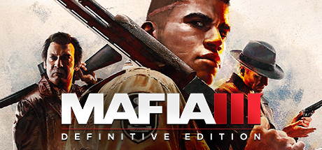

**Mafia III follows Vietnam veteran Lincoln Clay building a criminal empire in 1968 New Bordeaux to destroy the Italian mob that betrayed his family. Features a unique underboss loyalty system and an atmospheric Deep South setting.**

---

## 📖 About

Mafia III follows Vietnam veteran Lincoln Clay building a criminal empire in 1968 New Bordeaux to destroy the Italian mob that betrayed his family. Features a unique underboss loyalty system and an atmospheric Deep South setting.

## ⚠️ Problems Without Trainer

| Problem | Status |
|---------|--------|
| **Repetitive Mission Structure** — Side district missions repeat similar objective types extensively | ✅ Solved |
| **Underboss Loyalty** — Ignoring any underboss for too long triggers betrayal game overs | ✅ Solved |
| **Performance Issues** — Original release had frame rate locks; patches improved but not fully | ✅ Solved |
| **Collectible Volume** — Repenting, Vargas paintings, and playboys across a massive map | ✅ Solved |

## ✅ Solution

The **Mafia III Trainer** solves all these issues by giving you complete control over the game.

## 🎯 Full Feature List

- Unlimited Resources
- God Mode / Invincibility
- Instant Skill Cooldown
- One-Hit Kill
- Freeze Game Timer
- Unlock All Items & Achievements
- Custom Speed Multiplier
- Save State Anywhere

## 🚀 Quick Start

1. **Disable Windows Defender** temporarily (trainer may trigger false positive)
2. Download the trainer from the button above
3. Launch Mafia III
4. Run the trainer as Administrator
5. Activate desired cheats with hotkeys

## 💎 Free vs Paid

| Feature | Free | Pro |
|---------|------|-----|
| Basic God Mode | ✅ | ✅ |
| Unlimited Resources | ✅ | ✅ |
| All Advanced Cheats | ❌ | ✅ |
| Auto-Updates | ❌ | ✅ |
| Priority Support | ❌ | ✅ |

## 💻 Requirements

- Windows 10/11 (64-bit)
- Mafia III (any version)
- .NET Framework 4.8+
- DirectX 11+

## 🍎 macOS

macOS users can use our alternative tool:

## ⚖️ Legal

This trainer is for educational and single-player use only. Use responsibly.

---

